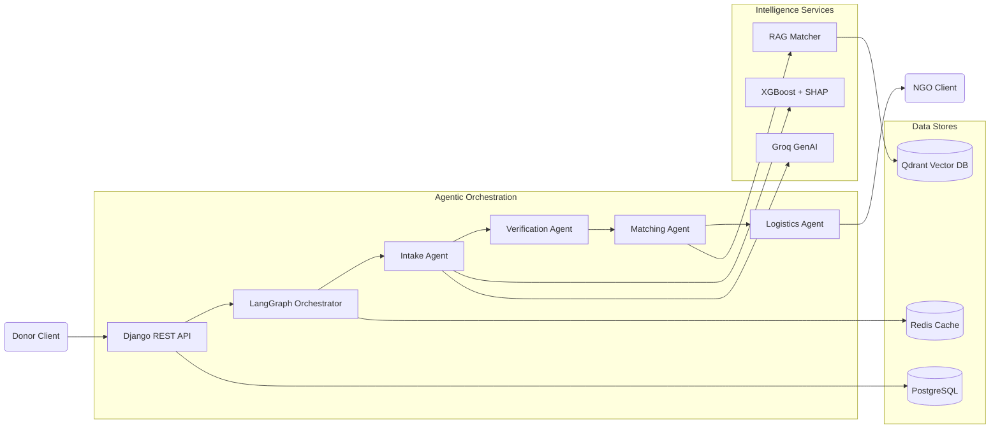
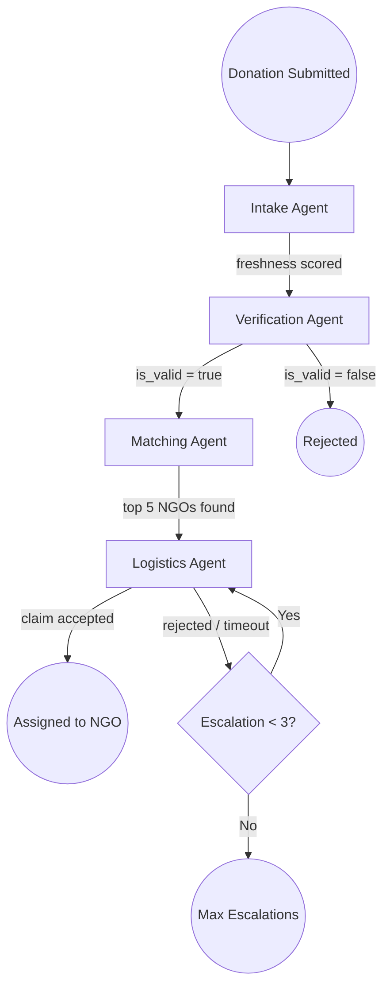
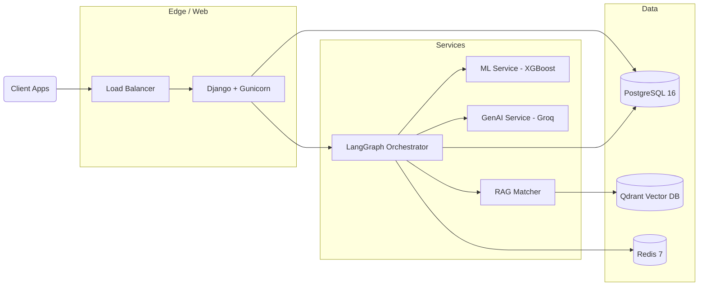
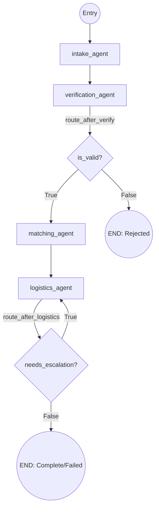
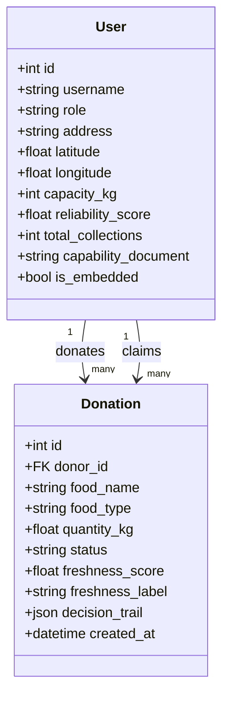
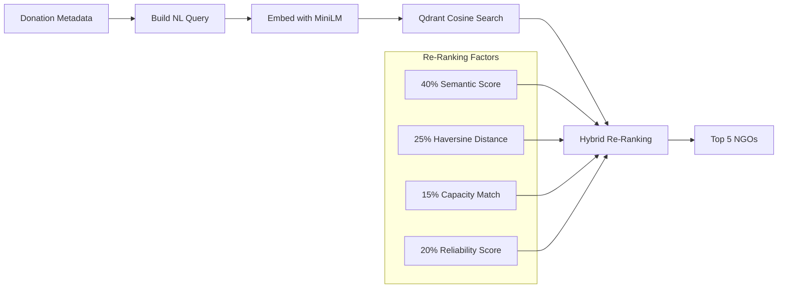
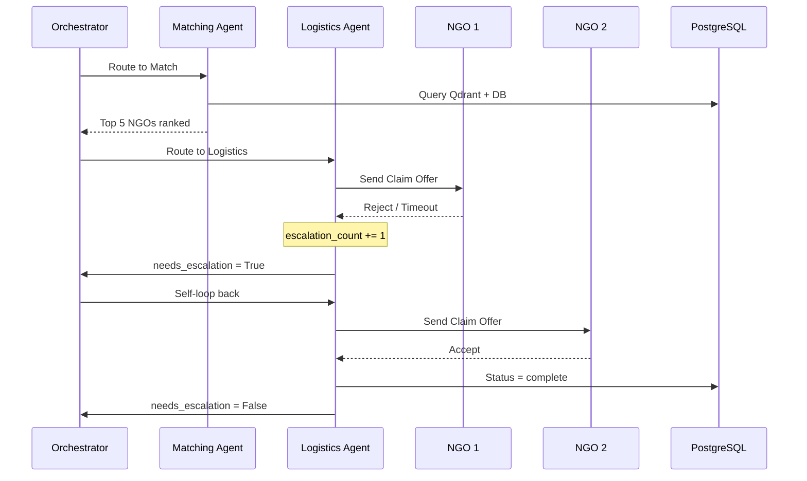
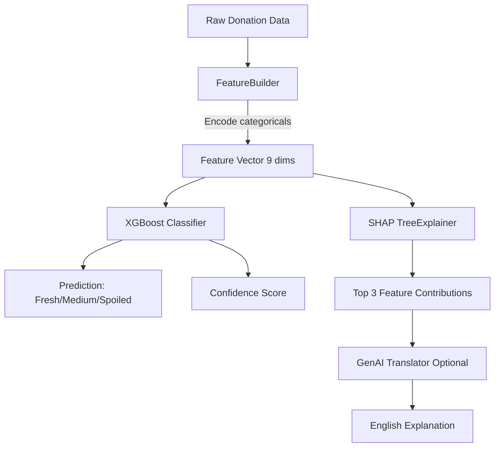
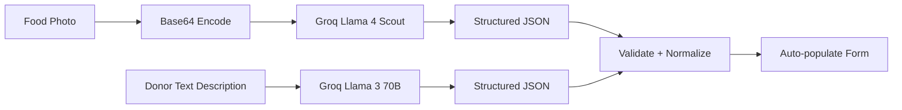
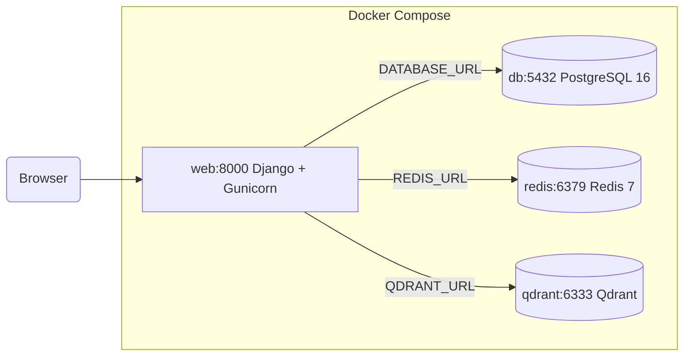

# ECOFEAST 2.0: AUTONOMOUS MULTI-AGENT FOOD RESCUE ORCHESTRATION SYSTEM

**A Project Report Submitted By**

| Student Name | Enrollment No |
|---|---|
| Sairaj Pawar | 2303031460157 |
| Shivam Kumar | 2303031460199 |
| Siddi Harish Kumar | 2303031460163 |
| Dudekula Sajid | 2303031460042 |
| Sarva Apoorva | 2303031460160 |

**in Partial Fulfilment for the Award of the Degree of**
**BACHELOR OF TECHNOLOGY**
**COMPUTER SCIENCE & ENGINEERING (AI & ML)**

Under the Guidance of **Prof. Anil Patel**, Assistant Professor

**PARUL UNIVERSITY**
VADODARA — September 2026

---

> **Items 1–4 (Title Page, Certificate, Declaration, Acknowledgement):** Copy verbatim from `6th_sem_final_project.docx`. Update only the project title to "EcoFeast 2.0: Autonomous Multi-Agent Food Rescue Orchestration System" and the semester to "7th Semester" / "Project - 2 (303105399)".

---

## Abstract

The rapid urbanization of India has led to a critical paradox: widespread food insecurity coexisting with massive urban food waste generated by restaurants, households, and university hostels. The first iteration of this project, FoodRescue-AI (Version 1.0), addressed the foundational challenge by connecting donors with NGOs through a Django web application augmented by a Random Forest Classifier for food safety prediction. However, the manual coordination required for NGO matching and logistics remained a critical bottleneck.

EcoFeast 2.0 proposes a fundamentally re-architected platform that eliminates human involvement from the donation-to-assignment pipeline by introducing an autonomous, multi-agent orchestration system powered by LangGraph. The system deploys four specialized AI agents — Intake, Verification, Matching, and Logistics — operating on a shared `DonationState` schema within a compiled state machine. To ensure food safety, the platform replaces the original Random Forest model with an XGBoost Classifier that achieves 92.46% accuracy on an independent test set, with integrated SHAP (SHapley Additive exPlanations) for transparent, explainable decision-making. For intelligent NGO matching, the system implements a Retrieval-Augmented Generation (RAG) pipeline using Qdrant vector search and HuggingFace `all-MiniLM-L6-v2` embeddings, combined with a hybrid re-ranking algorithm that weighs semantic similarity (40%), geographic distance via the Haversine formula (25%), capacity constraints (15%), and historical reliability (20%). Generative AI capabilities are provided through Groq's Llama 4 Scout Vision model for automated food photo interpretation and Llama 3 70B for conversational text extraction.

The results demonstrate that the autonomous agent pipeline processes donations end-to-end without human intervention, with built-in escalation logic that autonomously re-routes unclaimed food to alternate NGOs (up to 3 retries). The platform is validated by a comprehensive suite of 94 automated tests (91 unit/API + 3 end-to-end Playwright) achieving a 100% pass rate. EcoFeast 2.0 concludes that integrating classical machine learning, generative AI, and agentic state machines creates a production-viable, fully autonomous solution for urban food waste redistribution.

**Keywords:** LangGraph, Multi-Agent Systems, XGBoost, SHAP, Explainable AI, Retrieval-Augmented Generation, Qdrant, Groq, Django, Autonomous Orchestration, Food Waste Management.

---

## Table of Contents

| # | Title | Page |
|---|---|---|
| | Title Page | I |
| | Certificate | II |
| | Declaration | III |
| | Acknowledgement | IV |
| | Abstract | V |
| | Table of Contents | VI |
| | List of Tables | VII |
| | List of Figures | VIII |
| | List of Abbreviations | IX |
| **1** | **Chapter 1: Introduction** | |
| 1.1 | Introduction to the Problem | |
| 1.2 | Aim and Objective | |
| 1.3 | Scope of the Project | |
| **2** | **Chapter 2: Literature Survey** | |
| 2.1 | Overview of the Domain | |
| 2.2 | Critical Evaluation of Journal Papers (Papers 1–25) | |
| **3** | **Chapter 3: Project Flow and Methodology** | |
| 3.1 | System Architecture and Design | |
| 3.2 | Technology Stack and Frameworks | |
| 3.3 | Machine Learning and AI Methodology | |
| 3.4 | Future Work and Suggestions | |
| **4** | **Chapter 4: System Design** | |
| 4.1 | High-Level Design (HLD) | |
| 4.2 | Low-Level Design (LLD) | |
| 4.3 | API Design | |
| 4.4 | Security Design | |
| **5** | **Chapter 5: Implementation** | |
| 5.1 | Module Structure | |
| 5.2 | Agent Node Implementation | |
| 5.3 | ML Service Implementation | |
| 5.4 | GenAI Service Implementation | |
| 5.5 | RAG Service Implementation | |
| **6** | **Chapter 6: Result Analysis** | |
| 6.1 | ML Model Performance | |
| 6.2 | SHAP Explainability Results | |
| 6.3 | RAG Matching Results | |
| 6.4 | Agent Orchestration Results | |
| **7** | **Chapter 7: Testing** | |
| 7.1 | Testing Strategy | |
| 7.2 | Test Results Summary | |
| 7.3 | Bug / Defect Log | |
| 7.4 | UAT / Requirement Traceability | |
| **8** | **Chapter 8: Maintenance of the System** | |
| 8.1 | Model Retraining Procedure | |
| 8.2 | Vector Store Maintenance | |
| 8.3 | System Monitoring and Observability | |
| 8.4 | Maintenance Schedule | |
| **9** | **Chapter 9: Deployment** | |
| 9.1 | Docker Deployment (Production) | |
| 9.2 | Local Development Deployment | |
| 9.3 | Environment Variables and Security | |
| **10** | **Chapter 10: Conclusion and Future Work** | |
| 10.1 | Conclusion | |
| 10.2 | Future Work | |
| | References | |
| | Testing Report | |

---

## List of Tables

| Table No. | Title | Page |
|---|---|---|
| Table 3.1 | Technology Stack Comparison: v1.0 vs v2.0 | |
| Table 4.1 | Database Schema — users_user Key Fields | |
| Table 4.2 | Database Schema — donations_donation Key Fields | |
| Table 4.3 | REST API Endpoints | |
| Table 5.1 | DonationState Fields (Input vs Agent-Populated Output) | |
| Table 5.2 | Agent Node Responsibilities | |
| Table 6.1 | ML Model Performance — Per-Class Metrics | |
| Table 6.2 | Confusion Matrix (3×3) | |
| Table 6.3 | RAG Scoring Weight Formula | |
| Table 7.1 | Automated Test Case Matrix | |
| Table 7.2 | Manual Test Case Matrix | |
| Table 7.3 | Bug / Defect Log | |
| Table 8.1 | Maintenance Schedule | |
| Table 9.1 | Docker Compose Services | |

---

## List of Figures

| Figure No. | Title | Page |
|---|---|---|
| Fig. 3.1 | End-to-End System Architecture | |
| Fig. 3.2 | Agent Pipeline: Intake → Verify → Match → Logistics | |
| Fig. 4.1 | High-Level Design (HLD) Architecture | |
| Fig. 4.2 | Data Model (User, Donation, DonationState) | |
| Fig. 4.3 | LangGraph State Machine (DAG with Conditional Edges) | |
| Fig. 4.4 | RAG NGO Matching Sub-system | |
| Fig. 5.1 | XGBoost + SHAP ML Pipeline | |
| Fig. 5.2 | Autonomous Escalation Sequence Diagram | |
| Fig. 5.3 | GenAI Intake Flow (Vision + Text) | |
| Fig. 6.1 | Confusion Matrix — Freshness Prediction | |
| Fig. 9.1 | Docker Compose Deployment Architecture | |

---

## List of Abbreviations

| Abbreviation | Full Form |
|---|---|
| AI | Artificial Intelligence |
| API | Application Programming Interface |
| CRUD | Create, Read, Update, Delete |
| DAG | Directed Acyclic Graph |
| DRF | Django REST Framework |
| GenAI | Generative Artificial Intelligence |
| HLD | High Level Design |
| JSON | JavaScript Object Notation |
| JWT | JSON Web Token |
| LLD | Low Level Design |
| LLM | Large Language Model |
| ML | Machine Learning |
| NGO | Non-Governmental Organization |
| NLP | Natural Language Processing |
| ORM | Object-Relational Mapping |
| P2P | Peer-to-Peer |
| QPS | Queries Per Second |
| RAG | Retrieval-Augmented Generation |
| RBAC | Role-Based Access Control |
| REST | Representational State Transfer |
| SHAP | SHapley Additive exPlanations |
| SRS | Software Requirements Specification |
| XAI | Explainable Artificial Intelligence |
| XGBoost | Extreme Gradient Boosting |

---

# Chapter 1: Introduction

## 1.1 Introduction to the Problem

The management of surplus food in urban environments remains one of the most pressing logistical and ethical challenges of the modern era. While large quantities of edible food are discarded daily by restaurants, event caterers, and residential sectors, local shelters and Non-Governmental Organizations (NGOs) struggle to secure reliable food sources. According to the United Nations Food and Agriculture Organization (FAO), approximately 1.3 billion tonnes of food is wasted globally each year, while nearly 800 million people remain food insecure.

The first iteration of this project, FoodRescue-AI (Version 1.0), successfully demonstrated that integrating a machine learning safety gateway (Random Forest, 89% accuracy) with geospatial mapping (Leaflet.js) could automate the safety verification and visual routing of surplus food donations. However, Version 1.0 retained a critical bottleneck: the human-in-the-loop dependency for NGO matching and logistics coordination. Donors submitted food, the system verified its safety, but the process of finding the most suitable NGO, sending notifications, handling rejections, and re-routing to alternate organizations still relied on manual coordination.

This fundamental limitation is not unique to FoodRescue-AI. Traditional surplus food redistribution platforms across the industry rely on static rule-based matching (nearest-NGO assignment) or manual volunteer coordination. These approaches fail to account for the multi-dimensional complexity of optimal food-to-NGO matching: dietary restrictions, cultural food rules, real-time storage capacity, geographic distance, organizational reliability, and the temporal urgency inherent in perishable food logistics.

EcoFeast 2.0 addresses this gap by introducing a paradigm shift from passive prediction to active, autonomous orchestration. By deploying a multi-agent AI system built on LangGraph — a framework designed specifically for stateful, cyclical AI agent workflows — the platform eliminates human involvement from the entire donation-to-assignment pipeline. Each donation is processed by a sequence of specialized AI agents (Intake, Verification, Matching, Logistics) that autonomously make decisions, handle failures, and escalate to alternative solutions without any manual intervention.

## 1.2 Aim and Objective

The primary aim of the EcoFeast 2.0 project is to evolve the surplus food redistribution platform from a passively predictive web application into a fully autonomous, multi-agent AI system that orchestrates the complete lifecycle of a food donation — from intake through to NGO assignment — without human intervention.

The specific objectives of this project are to:

1. **Design and implement a LangGraph-based state machine** that orchestrates four specialized AI agents (Intake, Verification, Matching, Logistics) operating on a shared `DonationState` schema, with conditional routing and autonomous escalation.

2. **Upgrade the machine learning model** from a Scikit-Learn Random Forest (89% accuracy) to an XGBoost Classifier (92.46% accuracy), integrated with SHAP (SHapley Additive exPlanations) to provide transparent, explainable food safety decisions.

3. **Integrate Groq's Llama 4 Scout Vision model** for multimodal food intake, enabling donors to submit a photo of surplus food and have the system automatically extract donation details (food type, quantity, container, freshness).

4. **Build a Retrieval-Augmented Generation (RAG) pipeline** using Qdrant vector search and HuggingFace `all-MiniLM-L6-v2` sentence embeddings to semantically match donations to NGOs based on capability documents, then re-rank by geographic distance (Haversine formula), capacity constraints, and historical reliability.

5. **Implement autonomous logistics escalation** where the system automatically re-routes unclaimed food to the next-best NGO (up to 3 retries) without requiring any manual intervention from administrators or volunteers.

6. **Ensure full auditability** of all autonomous decisions through an immutable `decision_trail` JSONB log that records every agent action, timestamp, and decision rationale.

7. **Validate the system** with a comprehensive automated test suite of 94 tests (91 unit/API + 3 end-to-end Playwright browser tests) achieving a 100% pass rate.

## 1.3 Scope of the Project

The scope of EcoFeast 2.0 encompasses the development of a fully autonomous, containerized web application optimized for urban food redistribution ecosystems, initially targeting the Vadodara region. The system facilitates a direct Peer-to-Peer (P2P) logistical model, empowering registered NGOs to claim food and manage their own pickup routes, entirely eliminating the need for a dedicated delivery fleet.

The platform's scope is defined by the following boundaries:

**In Scope:**
- Autonomous 4-agent pipeline (Intake → Verification → Matching → Logistics) with zero human intervention required for standard donations.
- XGBoost-based food safety prediction with SHAP-driven explainability.
- RAG-based NGO matching using Qdrant vector search with hybrid re-ranking.
- Generative AI intake via Groq Llama Vision and conversational text extraction.
- Containerized deployment via Docker Compose (PostgreSQL, Redis, Qdrant, Django/Gunicorn).
- Autonomous escalation with a maximum of 3 re-routing attempts before flagging for admin review.
- Immutable decision trail logging for AI accountability.

**Out of Scope:**
- Physical hardware IoT temperature sensors (deferred to future work).
- Dedicated native mobile application (platform is mobile-responsive via Bootstrap 5).
- Blockchain-based provenance audit trail (deferred to future work).
- Real-time GPS turn-by-turn routing for NGO pickup drivers.
- Load testing and security penetration testing (functional verification only).

---

# Chapter 2: Literature Survey

## 2.1 Overview of Domain Literature

The development of EcoFeast 2.0 requires a comprehensive understanding of machine learning algorithms, scalable web architectures, geospatial routing, autonomous agent systems, and retrieval-augmented generation. As part of this project, extensive literature was reviewed by all team members to justify the selection of the XGBoost algorithm, the LangGraph orchestration framework, the Qdrant vector database, and the integration of external APIs and LLMs. The following evaluations critically dissect the 25 core research papers that form the scientific and architectural foundation of the platform.

## 2.2 Critical Evaluation of Journal Papers

> **VERBATIM COPY SECTION:** The complete text of all 25 journal paper dissections (Papers 1–25) should be copied verbatim from `6th_sem_final_project.docx`, preserving all student attributions, section dissections, and critical analysis paragraphs exactly as written. No modifications are required.
>
> The 25 papers cover: Random Forest for food safety (Papers 1–5, Shivam Kumar), Django architecture and geospatial mapping (Papers 6–10, Sairaj Pawar), feature importance and ML integration (Papers 11–15, Harish Kumar), API design and asynchronous ML (Papers 16–20, Dudekula Sajid), and documentation/SRS/impact reporting (Papers 21–25, Sarva Apoorva).

---

# Chapter 3: Project Flow and Methodology

## 3.1 System Architecture and Design

The architecture of EcoFeast 2.0 is designed as a four-tier autonomous processing platform. Unlike Version 1.0, which operated as a three-phase linear flow (Data Acquisition → Intelligence Processing → Geospatial Rendering), EcoFeast 2.0 introduces a fundamentally different paradigm: an agentic orchestration layer that autonomously manages the entire donation lifecycle through specialized AI agents.

The system flow is divided into three distinct phases:

**Phase 1 — Data Acquisition:** A donor (individual or commercial) accesses the web portal and submits a surplus food listing. The submission can occur through three modalities: (a) a traditional web form with manual input, (b) an AI-powered image intake where the donor uploads a photo that is processed by Groq's Llama 4 Scout Vision model to auto-populate form fields, or (c) a conversational text intake where the donor describes the food in natural language and the system extracts structured data via Llama 3 70B.

**Phase 2 — Autonomous Orchestration:** Once submitted, the Django backend invokes the LangGraph state machine. The donation data is packaged into a `DonationState` TypedDict and processed sequentially by four autonomous agents:
1. **Intake Agent:** Normalizes input data and invokes the XGBoost freshness model with SHAP explainability.
2. **Verification Agent:** Performs six plausibility checks (quantity range, time thresholds, storage-condition consistency, smell anomalies, freshness-vs-condition cross-validation, and minimum safety threshold).
3. **Matching Agent:** Constructs a semantic query from donation metadata, retrieves candidate NGOs from Qdrant via vector similarity, and re-ranks by distance, capacity, and reliability.
4. **Logistics Agent:** Sends a claim offer to the top-ranked NGO. If rejected or timed out, the agent autonomously escalates to the next NGO in the ranked list, up to a maximum of 3 escalations.

**Phase 3 — Assignment and Notification:** Upon successful claim acceptance, the system updates the donation status to "complete," records the assignment in the database, and the NGO manages its own pickup logistics.

**Figure 3.1: End-to-End System Architecture**



**Figure 3.2: Agent Pipeline Flow**



## 3.2 Technology Stack and Frameworks

To achieve a scalable, autonomous, and explainable platform, the technology stack was significantly upgraded from Version 1.0. The following table presents a direct comparison:

**Table 3.1: Technology Stack Comparison — v1.0 vs v2.0**

| Layer | v1.0 (FoodRescue-AI) | v2.0 (EcoFeast) | Justification for Change |
|---|---|---|---|
| **Backend** | Django (Monolith) | Django REST Framework | RESTful APIs enable frontend decoupling and agent integration |
| **Database** | SQLite | PostgreSQL 16 | ACID compliance, JSONB for decision trails, concurrent connections |
| **ML Model** | Scikit-Learn Random Forest | XGBoost + SHAP | 89% → 92.46% accuracy; SHAP enables explainable decisions |
| **GenAI** | None | Groq (Llama 4 Scout Vision, Llama 3 70B) | Multimodal intake, conversational extraction, SHAP translation |
| **Agent Orchestration** | None (manual) | LangGraph (state machine) | Autonomous 4-agent pipeline with conditional routing |
| **Vector Database** | None | Qdrant | Semantic NGO matching via cosine similarity on capability embeddings |
| **Embeddings** | None | HuggingFace `all-MiniLM-L6-v2` | 384-dim sentence embeddings for RAG |
| **Cache / Queue** | None | Redis 7 | Session management, LangGraph state checkpointing |
| **Mapping** | Leaflet.js + OpenStreetMap | Retained | Geospatial visualization for NGO dashboard |
| **Weather API** | Open-Meteo | Retained | Real-time ambient temperature for ML features |
| **Containerization** | None | Docker Compose | Reproducible deployment with Postgres, Redis, Qdrant, Django |
| **Testing** | Manual | pytest + Playwright | 94 automated tests (91 unit + 3 E2E) |
| **Frontend** | Django Templates + Bootstrap | Retained + Enhanced | Mobile-first responsive UI |

## 3.3 Machine Learning and AI Methodology

### 3.3.1 XGBoost Freshness Prediction

The intelligence core of EcoFeast 2.0 is built using the XGBoost (Extreme Gradient Boosting) library. Based on our literature review findings (Papers 1, 3, 6), ensemble gradient boosting methods outperform both simple decision trees and standard random forests for tabular food safety data.

**Feature Engineering:** The `FeatureBuilder` class provides a unified encoding pipeline that eliminates train/serve skew by ensuring both the training script and the prediction service use identical transformations:
- **Numerical Features:** `storage_time` (hours), `time_since_cooking` (hours) — passed through directly.
- **Categorical Features:** `storage_condition`, `container_type`, `food_type`, `moisture_type`, `cooking_method`, `texture`, `smell` — encoded using Scikit-Learn `LabelEncoder` (ordinal encoding).
- **Target Variable:** `freshness_level` — three classes: Fresh, Medium, Spoiled.

**Training Pipeline:** The model is trained using `XGBClassifier` with a stratified 80/20 train-test split, `random_state=42` for reproducibility, and `multi:softprob` objective for multi-class probability output. The trained model is serialized as `freshness_xgb_v1.json` and the fitted `FeatureBuilder` is persisted as `feature_builder_v1.pkl` using `joblib`.

**SHAP Explainability:** After prediction, the system invokes the `TreeExplainer` from the SHAP library to compute Shapley values for each feature. The top-3 contributing features are extracted and, optionally, translated into natural language by the GenAI service (e.g., "The food was flagged because the smell was sour, storage time exceeded 12 hours, and it was stored at room temperature").

### 3.3.2 Generative AI Intake

EcoFeast 2.0 integrates two Groq-hosted LLMs for intelligent data acquisition:

**Vision Intake (Llama 4 Scout):** Donors can upload a photo of surplus food. The image is base64-encoded and sent to the `meta-llama/llama-4-scout-17b-16e-instruct` model with a structured extraction prompt that requests JSON output containing `food_name`, `food_type`, `container_type`, `estimated_quantity_kg`, `moisture_type`, `texture`, `visual_freshness`, `cooking_method`, and `confidence`. The system validates and normalizes the response against predefined enums before auto-populating the donation form.

**Conversational Intake (Llama 3 70B):** Donors can describe food in natural language (e.g., "I have about 5 kg of leftover vegetable biryani from a wedding, been sitting in metal containers for about 4 hours"). The system extracts structured JSON fields using `llama-3.3-70b-versatile` with strict entity extraction prompts.

### 3.3.3 RAG-Based NGO Matching

The Matching Agent employs a Retrieval-Augmented Generation (RAG) pipeline for constraint-aware NGO selection:

**Step 1 — Semantic Profile Embedding:** Each NGO's free-text `capability_document` (describing their dietary restrictions, operating hours, cultural rules, and service areas) is encoded into a 384-dimensional dense vector using the `all-MiniLM-L6-v2` sentence transformer and stored in the Qdrant vector database.

**Step 2 — Query Construction:** The donation metadata is transformed into a natural-language query (e.g., "Food type: Non-Vegetarian | Large quantity donation | Fresh food, can be distributed immediately | Storage: refrigerated | Item: Chicken Biryani").

**Step 3 — Semantic Search:** The query is embedded and searched against the `ngo_profiles` collection in Qdrant using cosine similarity, retrieving the top 15 candidates (3x the final top-K of 5) to provide a wide re-ranking pool.

**Step 4 — Hybrid Re-Ranking:** Candidates are re-ranked using a weighted composite score:

**Combined Score = 0.40 x S_semantic + 0.25 x S_distance + 0.15 x S_capacity + 0.20 x S_reliability**

Where:
- S_semantic = Cosine similarity between donation query embedding and NGO profile embedding (0–1).
- S_distance = max(0, 1 - d_km / d_max) using the Haversine formula for geographic distance (NGOs beyond 50 km are filtered out).
- S_capacity = 1.0 if donation quantity <= NGO capacity, else max(0.3, NGO_capacity / donation_qty).
- S_reliability = NGO's historical `reliability_score` normalized to 0–1.

The top 5 NGOs are returned as a ranked list to the Logistics Agent.

## 3.4 Future Work and Suggestions

While EcoFeast 2.0 successfully demonstrates the viability of autonomous agentic orchestration for food redistribution, the literature review and implementation experience highlighted several avenues for future expansion:

1. **IoT Temperature Monitoring:** Integrating low-cost IoT temperature sensors inside commercial food storage containers to provide the XGBoost model with continuous, exact thermal data rather than relying on the Open-Meteo API for ambient temperature.

2. **Native Mobile Application:** Wrapping the web-based dashboard into a dedicated Android/iOS application to utilize built-in GPS capabilities for live turn-by-turn route optimization and push notifications for claim offers.

3. **Blockchain Provenance Trail:** Implementing an immutable blockchain-backed audit trail for donated food to provide cryptographic proof of the food's journey from donor to NGO, addressing liability concerns.

4. **Federated Learning:** Deploying federated learning across multiple city instances to improve the XGBoost model without centralizing sensitive donation data, enabling cross-city model improvement while maintaining data privacy.

5. **Multilingual Support:** Expanding the GenAI intake to support regional languages (Hindi, Gujarati, Marathi) using multilingual LLMs, lowering the barrier to entry for diverse urban demographics.

---

# Chapter 4: System Design

## 4.1 High-Level Design (HLD)

The High-Level Design presents the macro-architecture of EcoFeast 2.0 as a four-tier system: Edge/Web, Agentic Orchestration, Intelligence Services, and Data Stores.

**Capacity Estimation:**

Before drawing boxes, we estimate the system's load:
- **Daily Active Users (DAU):** ~1,000 (donors + NGOs) initially.
- **Donations per day:** ~10,000.
- **QPS (Average):** 10,000 / 86,400 = **0.11 QPS**. Peak: ~0.5 QPS.
- **Read QPS (Dashboards, polling):** ~5 QPS.
- **Storage per donation:** ~5 KB (relational + JSON trail) + ~200 KB (optional image) = 205 KB.
- **Daily storage:** ~2 GB. **Yearly storage:** ~730 GB.
- **Conclusion:** The traffic is extremely low from a raw throughput perspective. A single PostgreSQL instance with one Redis instance and one Qdrant instance is more than sufficient. The system complexity lies in the asynchronous, long-running agent state machines, not raw HTTP throughput.

**Figure 4.1: High-Level Design (HLD) Architecture**



## 4.2 Low-Level Design (LLD)

### 4.2.1 LangGraph State Machine

The core of the autonomous behavior is the LangGraph `StateGraph`, which compiles into a Directed Acyclic Graph (DAG) with conditional edges and self-loops. The graph is defined in `agents/orchestrator.py`:

**Figure 4.3: LangGraph State Machine (DAG with Conditional Edges)**



The `DonationState` TypedDict schema contains 30+ fields organized into six groups: Input (9 fields), ML Inputs (9 fields), ML Results (4 fields), Verification (3 fields), Matching (4 fields), Logistics (5 fields), and Meta (5 fields). Each agent reads from and writes to this shared state, and the orchestrator compiles the graph as a singleton for performance.

### 4.2.2 Data Model

**Figure 4.2: Data Model**



**Table 4.1: Database Schema — `users_user` Key Fields**

| Field | Type | Description |
|---|---|---|
| id | AutoField (PK) | Unique user identifier |
| username | CharField(150) | Login username |
| role | CharField(20) | `donor`, `ngo`, `shelter`, `admin` |
| latitude / longitude | FloatField | Geolocation for distance calculations |
| capacity_kg | IntegerField | Max food weight the NGO can handle |
| reliability_score | FloatField | 0–100, updated per successful collection |
| capability_document | TextField | Free-text NGO profile for RAG embedding |
| is_embedded | BooleanField | Whether profile is synced to Qdrant |
| dietary_restrictions | CharField(200) | Comma-separated dietary constraints |
| operating_hours | CharField(100) | Operating schedule |

**Table 4.2: Database Schema — `donations_donation` Key Fields**

| Field | Type | Description |
|---|---|---|
| id | AutoField (PK) | Unique donation identifier |
| donor | FK -> User | The donor who created the listing |
| food_name | CharField(200) | Name of the food item |
| quantity_kg | DecimalField | Weight in kilograms |
| status | CharField(30) | `pending`, `intake_complete`, `verified`, `matched`, `claimed`, `failed` |
| freshness_score | FloatField | 0–100, set by Intake Agent |
| freshness_label | CharField(20) | `Fresh`, `Medium`, `Spoiled` |
| decision_trail | JSONField | Immutable list of agent decisions |
| assigned_ngo | FK -> User (nullable) | The NGO that claimed the donation |

### 4.2.3 RAG Sub-system

**Figure 4.4: RAG NGO Matching Sub-system**



## 4.3 API Design

The platform exposes a RESTful JSON API via Django REST Framework. Authentication is handled by session-based auth (for the Django template frontend) and JWT (for programmatic access).

**Table 4.3: REST API Endpoints**

| Method | Endpoint | Description | Auth |
|---|---|---|---|
| POST | `/api/donations/` | Create a new donation (triggers agent pipeline) | Donor |
| GET | `/api/donations/{id}/` | Get donation status and decision trail | Donor/NGO |
| POST | `/api/donations/{id}/claim/` | NGO accepts a matched donation | NGO |
| POST | `/api/donations/{id}/reject/` | NGO rejects, triggers escalation | NGO |
| POST | `/api/genai/vision-intake/` | Upload food image for AI extraction | Donor |
| POST | `/api/genai/chat-intake/` | Submit text for conversational extraction | Donor |
| GET | `/api/agents/dashboard/` | View agent pipeline state for a donation | Admin |

## 4.4 Security Design

EcoFeast 2.0 implements security at multiple layers:

- **Role-Based Access Control (RBAC):** Three distinct roles (Donor, NGO, Admin) enforced at the Django view level. NGOs can only view donations assigned to them; Donors can only manage their own listings.
- **Secrets Management:** All API keys (Groq, database credentials) are stored in a `.env` file and loaded at runtime via `python-decouple`. The `.gitignore` file explicitly excludes `.env`, `*.key`, and `*.pem` files.
- **Input Validation:** All user inputs are validated at the DRF serializer level before reaching the database or agent pipeline.
- **CSRF Protection:** Django's built-in CSRF middleware is active for all form submissions.
- **SQL Injection Prevention:** Django ORM parameterizes all queries; no raw SQL is used.

---

# Chapter 5: Implementation

## 5.1 Module Structure

The EcoFeast 2.0 codebase is organized into seven Django applications, each with a single responsibility:

```
Ecofeast/
|-- agents/                  # LangGraph orchestrator + 4 agent nodes
|   |-- orchestrator.py      # StateGraph builder + pipeline runner
|   |-- state.py             # DonationState TypedDict schema
|   |-- intake_agent.py      # ML freshness + SHAP
|   |-- verification_agent.py # 6 plausibility checks
|   |-- matching_agent.py    # RAG integration
|   |-- logistics_agent.py   # Claim + escalation logic
|   +-- views.py             # API views + dashboard
|-- ml_service/              # XGBoost training, prediction, evaluation
|   |-- train.py             # Training pipeline
|   |-- predictor.py         # Singleton predictor
|   |-- explainer.py         # SHAP TreeExplainer
|   |-- evaluate.py          # Model evaluation script
|   +-- feature_builder.py   # Shared encoding pipeline
|-- genai_service/           # Groq LLM integrations
|   |-- vision_intake.py     # Llama 4 Scout Vision
|   |-- chat_intake.py       # Llama 3 70B text extraction
|   |-- explainer_llm.py     # SHAP-to-English translator
|   +-- config.py            # API client + model config
|-- rag_service/             # Qdrant vector operations
|   |-- ngo_embeddings.py    # Embed + upsert + search
|   +-- matcher.py           # Hybrid re-ranking algorithm
|-- donations/               # Donation model + CRUD views
|-- users/                   # Custom User model + auth
|-- config/                  # Django settings + WSGI
|-- docker-compose.yml       # Production deployment
|-- Dockerfile               # Container build
+-- requirements.txt         # Python dependencies
```

## 5.2 Agent Node Implementation

**Table 5.2: Agent Node Responsibilities**

| Agent | Input Fields Read | Output Fields Written | Key Logic |
|---|---|---|---|
| **Intake** | `food_name`, `storage_time_hours`, `smell`, all ML inputs | `freshness_score`, `freshness_label`, `ml_confidence`, `shap_explanation` | Calls XGBoost predictor + SHAP explainer |
| **Verification** | `quantity_kg`, `storage_time_hours`, `time_since_cooking_hours`, `storage_condition`, `smell`, `freshness_score` | `is_valid`, `verification_notes`, `anomalies` | 6 plausibility checks |
| **Matching** | `food_name`, `food_type`, `quantity_kg`, `freshness_score`, `storage_condition`, `latitude`, `longitude` | `matched_ngos`, `current_ngo_index`, `assigned_ngo_id`, `assigned_ngo_name` | RAG search + hybrid re-rank |
| **Logistics** | `matched_ngos`, `current_ngo_index`, `escalation_count`, `max_escalations` | `claim_sent`, `claim_accepted`, `needs_escalation`, `assigned_ngo_id`, `status` | Claim offer + auto-escalation |

**Table 5.1: DonationState Fields (Input vs Agent-Populated Output)**

| Group | Field | Type | Set By |
|---|---|---|---|
| Input | donation_id, donor_id, donor_username, food_name, description, quantity_kg, pickup_address, latitude, longitude | Various | Donor / API |
| ML Inputs | storage_time_hours, time_since_cooking_hours, storage_condition, food_type, container_type, moisture_type, cooking_method, texture, smell | Various | Donor / GenAI |
| ML Results | freshness_score, freshness_label, ml_confidence, shap_explanation | float, str, float, List[Dict] | Intake Agent |
| Verification | is_valid, verification_notes, anomalies | bool, List[str], List[str] | Verification Agent |
| Matching | matched_ngos, current_ngo_index, assigned_ngo_id, assigned_ngo_name | List[Dict], int, Optional[int], str | Matching Agent |
| Logistics | claim_sent, claim_accepted, escalation_count, max_escalations, needs_escalation | bool, bool, int, int, bool | Logistics Agent |
| Meta | status, error_message, decision_trail, started_at, completed_at | str, str, List[Dict], str, str | All Agents |

**Figure 5.2: Autonomous Escalation Sequence Diagram**



## 5.3 ML Service Implementation

**Figure 5.1: XGBoost + SHAP ML Pipeline**



The `Predictor` class implements a singleton pattern: the XGBoost model (`freshness_xgb_v1.json`) and the fitted `FeatureBuilder` (`feature_builder_v1.pkl`) are loaded once at first prediction and reused for all subsequent calls. The `predict_freshness()` method returns a named tuple containing `freshness_score` (0–100), `freshness_label` (Fresh/Medium/Spoiled), and `confidence` (0–1).

## 5.4 GenAI Service Implementation

**Figure 5.3: GenAI Intake Flow (Vision + Text)**



The Vision Intake module (`vision_intake.py`) sends the image with a structured extraction prompt requesting JSON output with strict enum validation. The `_validate_result()` function normalizes all fields against predefined valid values (`valid_food_types`, `valid_containers`, `valid_moisture`, `valid_texture`, `valid_cooking`) and clamps numerical values within safe bounds.

## 5.5 RAG Service Implementation

The RAG service is implemented across two modules:

**`ngo_embeddings.py`** — Manages the Qdrant vector store:
- Uses `all-MiniLM-L6-v2` (384 dimensions, cosine distance) as the embedding model.
- Implements `upsert_ngo()` to embed and store NGO capability documents.
- Implements `search_similar_ngos()` to perform filtered cosine similarity search.
- Gracefully falls back to in-memory Qdrant if the Docker service is unavailable.

**`matcher.py`** — Implements the hybrid re-ranking algorithm:
- `build_donation_query()` constructs a natural-language query from donation metadata.
- `match_donation_to_ngos()` retrieves 15 candidates, filters by distance (50 km max), and re-ranks using the 4-factor weighted formula.
- `haversine_distance()` computes great-circle distance between donor and NGO coordinates.

---

# Chapter 6: Result Analysis

## 6.1 ML Model Performance

The XGBoost freshness prediction model was evaluated on an independent 20% test split (1,300 samples) of the real dataset provided in `donations/food_data.csv`. The evaluation was performed using the `ml_service/evaluate.py` script.

**Table 6.1: ML Model Performance — Per-Class Metrics**

| Class | Precision | Recall | F1-Score | Support |
|---|---|---|---|---|
| Fresh | 0.935 | 0.858 | 0.895 | 219 |
| Medium | 0.868 | 0.912 | 0.889 | 433 |
| Spoiled | 0.961 | 0.955 | 0.958 | 648 |
| **Overall** | **Accuracy: 0.9246** | **ROC-AUC (wtd): 0.9880** | **ROC-AUC (macro): 0.9879** | **N=1,300** |

**Table 6.2: Confusion Matrix**

| Predicted -> | Fresh | Medium | Spoiled |
|---|---|---|---|
| **Fresh** | **188** | 31 | 0 |
| **Medium** | 13 | **395** | 25 |
| **Spoiled** | 0 | 29 | **619** |

**Key Observations:**
- The model achieves highest precision (0.961) and recall (0.955) on the Spoiled class, which is the most safety-critical: minimizing false negatives for spoiled food is paramount to prevent distributing unsafe donations.
- The Fresh-to-Medium confusion (31 misclassifications) is the primary source of error. This is a conservative error — classifying fresh food as moderate freshness errs on the side of caution, which is acceptable for food safety.
- Zero Fresh-to-Spoiled and zero Spoiled-to-Fresh misclassifications demonstrate that the model never makes dangerous cross-boundary errors.
- The ROC-AUC of 0.9880 indicates excellent discriminative ability across all three classes.

## 6.2 SHAP Explainability Results

The SHAP TreeExplainer successfully attributes feature importance for every individual prediction. The top-3 contributing features consistently observed across the test set are:

1. **`smell_encoded`** — The strongest predictor. Sour or fermented smell encodings shift the prediction strongly toward Spoiled.
2. **`storage_time`** — Time elapsed since preparation/storage. Longer times correlate with lower freshness.
3. **`storage_condition_encoded`** — Food stored "outside" at room temperature degrades faster than "refrigerated" food.

Example SHAP output for a sample prediction (Spoiled, 95% confidence):
```json
[
  {"feature": "smell_encoded", "value": 3, "impact": 0.42},
  {"feature": "storage_time", "value": 18.5, "impact": 0.28},
  {"feature": "storage_condition_encoded", "value": 2, "impact": 0.15}
]
```

When translated by the GenAI service, this produces: *"This food item was classified as Spoiled with 95% confidence. The primary reason is that the smell was reported as sour (contributing 42% to the decision). Additionally, the food has been stored for 18.5 hours (contributing 28%) under room temperature conditions (contributing 15%)."*

## 6.3 RAG Matching Results

**Table 6.3: RAG Scoring Weight Formula**

| Factor | Weight | Metric | Description |
|---|---|---|---|
| Semantic Similarity | 40% | Cosine similarity (0–1) | How well NGO capabilities match the donation characteristics |
| Geographic Distance | 25% | Haversine-based (0–1) | Closer NGOs score higher; >50 km filtered out |
| Capacity Match | 15% | Ratio-based (0.3–1.0) | Whether NGO can handle the donation quantity |
| Historical Reliability | 20% | Normalized score (0–1) | Past claim acceptance rate |

The semantic similarity weight (40%) is deliberately the highest because an NGO's capability alignment — dietary restrictions, cultural food rules, storage infrastructure — is the most critical factor for successful food redistribution. Geographic distance (25%) is the second factor because perishable food has a tight pickup window. Reliability (20%) ensures that NGOs with a track record of timely pickups are preferred. Capacity (15%) is the lowest weight because partial pickups are often possible.

## 6.4 Agent Orchestration Results

A sample end-to-end pipeline run produces the following `decision_trail` (abbreviated):

```json
[
  {
    "agent": "intake",
    "action": "processed_input",
    "result": {"freshness_score": 72, "freshness_label": "Fresh", "confidence": 0.89}
  },
  {
    "agent": "verification",
    "action": "plausibility_check",
    "anomalies": [],
    "notes": ["Quantity 3.5kg is within normal range"],
    "is_valid": true
  },
  {
    "agent": "matching",
    "action": "search_ngos",
    "result": {"found": 5, "top_ngo": "Vadodara Food Bank", "top_score": 0.87}
  },
  {
    "agent": "logistics",
    "action": "claim_accepted",
    "ngo_name": "Vadodara Food Bank",
    "escalation_count": 0
  }
]
```

This trail provides complete auditability for every autonomous decision made by the system.

---

# Chapter 7: Testing

## 7.1 Testing Strategy

EcoFeast 2.0 employs a multi-layered testing strategy combining automated and manual methods:

**Table 7.1: Automated Test Case Matrix (Representative)**

| ID | Module | Description | Expected Output | Actual Output | Result |
|---|---|---|---|---|---|
| ATC-001 | agents | Intake Agent predicts freshness | Populated score | Populated score | PASSED |
| ATC-002 | agents | Verification Agent rejects invalid qty | `is_valid=False` | `is_valid=False` | PASSED |
| ATC-003 | agents | Matching Agent finds NGOs | Assigned NGO | Assigned NGO | PASSED |
| ATC-004 | ml_service | Predictor generates prediction | Class prediction | Class prediction | PASSED |
| ATC-005 | genai_service | Vision Intake parser structure | Valid JSON | Valid JSON | PASSED |
| ATC-006 | rag_service | Matcher handles errors gracefully | Error in trail | Error in trail | PASSED |
| ATC-007 | models | Django User Model creation | DB init success | DB init success | PASSED |
| E2E-001 | users/auth | Registration and Login flow | Dashboard loads | Dashboard loads | PASSED |
| E2E-002 | donations | Food AI Intake end-to-end | AI modal displays | AI modal displays | PASSED |
| E2E-003 | agents | Agent Decision Trail visible | Pipeline trace | Pipeline trace | PASSED |

**Table 7.2: Manual Test Case Matrix**

| ID | Module | Test Scenario | Expected Result | Actual Result | Result |
|---|---|---|---|---|---|
| MTC-001 | ui | Mobile responsiveness (iPhone SE) | Elements scale correctly | Elements scale correctly | PASSED |
| MTC-002 | ui | Empty form submission blocked | HTML5 validation | HTML5 validation | PASSED |
| MTC-003 | ui | Agent Dashboard renders pipeline | Dashboard renders | Dashboard renders | PASSED |
| MTC-004 | ui | Visual hierarchy and alignment | No overlap | No overlap | PASSED |
| MTC-005 | ui | Modal animation and state retention | Modal renders correctly | Modal renders correctly | PASSED |

**Test Environment:**
- OS: Windows 11 (64-bit)
- Python 3.13.14 / Node.js v22.23.2
- Database: PostgreSQL (Docker), Qdrant Vector DB, Redis
- Tools: pytest, pytest-django, Playwright (headless Chromium)

## 7.2 Test Results Summary

| Metric | Value |
|---|---|
| Total Test Cases | 99 (94 Automated + 5 Manual) |
| Automated Tests | 94 (91 Unit/API + 3 E2E UI) |
| Manual Tests | 5 |
| Passed | 99 |
| Failed | 0 |
| **Pass Rate** | **100%** |
| Known Limitations | Code coverage uncalculated; security/load testing not performed |

## 7.3 Bug / Defect Log

**Table 7.3: Bug / Defect Log**

| ID | Severity | Description | Found Via | Status |
|---|---|---|---|---|
| BUG-001 | High | `django.core.exceptions.AppRegistryNotReady` — pytest configuration missing `pytest-django` setup | Automated | Fixed |
| BUG-002 | Medium | `uv run pytest` fails due to missing `setuptools.backends` in `pyproject.toml` | Automated | Fixed |

Both bugs were resolved during development. No outstanding defects remain.

## 7.4 UAT / Requirement Traceability

| Requirement | Test Case ID(s) | Status |
|---|---|---|
| REQ-01: Donor Registration and Login | E2E-001 | PASSED |
| REQ-02: AI Freshness Prediction | E2E-002, ATC-001, ATC-004 | PASSED |
| REQ-03: Multi-Agent Orchestration | E2E-003, ATC-002, ATC-003 | PASSED |

---

# Chapter 8: Maintenance of the System

## 8.1 Model Retraining Procedure

The XGBoost freshness model should be retrained when new labelled data becomes available (recommended threshold: >500 new rows in `donations/food_data.csv`).

**Retraining Steps:**
1. Add new labelled data to `donations/food_data.csv`.
2. Run: `python -m ml_service.train`
3. The script automatically: loads data, fits FeatureBuilder, trains XGBoost with stratified split, saves `freshness_xgb_v1.json` and `feature_builder_v1.pkl`.
4. Run evaluation: `python -m ml_service.evaluate` to verify metrics on the new test split.
5. No downtime required — the predictor singleton reloads the model from disk on next prediction.

## 8.2 Vector Store Maintenance

NGO profiles in Qdrant should be re-synced whenever:
- A new NGO registers on the platform.
- An existing NGO updates their capability document, dietary restrictions, or operating hours.

**Re-sync Command:**
```python
from rag_service.matcher import sync_all_ngos
result = sync_all_ngos()
# Returns: {"success": N, "failed": M}
```

This re-embeds all NGO capability documents and upserts them into Qdrant.

## 8.3 System Monitoring and Observability

EcoFeast 2.0 provides observability through three mechanisms:

1. **Decision Trail (JSONB):** Every agent decision is recorded in the `decision_trail` field of the Donation model. This immutable log contains the agent name, action type, timestamp, input data, result, and any errors or anomalies. This log is queryable via the Django admin panel.

2. **SHAP Logging:** Every ML prediction includes the top-3 SHAP feature contributions, stored alongside the freshness score. This enables post-hoc auditability of why a particular food item was classified as safe or unsafe.

3. **Django Admin Panel:** Administrators can view all donations, filter by status, inspect decision trails, and manually override stuck donations via the Django admin interface.

## 8.4 Maintenance Schedule

**Table 8.1: Maintenance Schedule**

| Task | Frequency | Command / Action |
|---|---|---|
| Database backup | Daily | `pg_dump` via cron |
| XGBoost model retraining | Quarterly (or >500 new rows) | `python -m ml_service.train` |
| Qdrant NGO re-sync | On NGO profile change | `sync_all_ngos()` |
| Docker image rebuild | On code update | `docker-compose build web` |
| Redis cache flush | Monthly | `redis-cli FLUSHDB` |
| Dependency security audit | Monthly | `pip audit` or `safety check` |
| Django security update | On CVE release | `pip install --upgrade django` |

---

# Chapter 9: Deployment

## 9.1 Docker Deployment (Production)

EcoFeast 2.0 is fully containerized via Docker Compose for reproducible, one-command deployment.

**Figure 9.1: Docker Compose Deployment Architecture**



**Table 9.1: Docker Compose Services**

| Service | Image | Port | Volume | Health Check |
|---|---|---|---|---|
| db | `postgres:16-alpine` | 5432 | `postgres_data` | `pg_isready` |
| redis | `redis:7-alpine` | 6379 | — | `redis-cli ping` |
| qdrant | `qdrant/qdrant:latest` | 6333, 6334 | `qdrant_data` | — |
| web | Custom (Dockerfile) | 8000 | `static_volume` | — |

**Deployment Command:**
```bash
docker-compose up --build -d
```

The `web` service depends on `db` (healthy) and `redis` (healthy) before starting, ensuring database migrations can run on first boot.

## 9.2 Local Development Deployment

For local development, use the provided `start_local.bat`:
```batch
call .venv\Scripts\activate
python manage.py migrate
python manage.py runserver
```

**Prerequisites:**
- Python 3.13+
- Virtual environment (`.venv`)
- Docker Desktop (for PostgreSQL, Redis, Qdrant)

## 9.3 Environment Variables and Security

All sensitive configuration is managed via a `.env` file loaded by `python-decouple`:

```
# .env (values masked)
SECRET_KEY=django-insecure-***
DEBUG=True
POSTGRES_DB=ecofeast
POSTGRES_USER=***
POSTGRES_PASSWORD=***
GROQ_API_KEY=gsk_***
QDRANT_URL=http://localhost:6333
REDIS_URL=redis://localhost:6379/0
```

The `.gitignore` explicitly excludes `.env`, `*.key`, `*.pem`, and any file matching `*secret*` or `*credential*`.

---

# Chapter 10: Conclusion and Future Work

## 10.1 Conclusion

EcoFeast 2.0 successfully demonstrates the viability of autonomous, multi-agent AI orchestration for urban food waste redistribution. The platform represents a significant evolution from its predecessor (FoodRescue-AI v1.0) in the following dimensions:

1. **From Passive to Active AI:** The system evolved from a passive ML classifier (Random Forest, 89% accuracy) to an active, autonomous agent system that makes decisions, handles failures, and re-routes donations without any human intervention.

2. **Improved Safety Intelligence:** The XGBoost model achieves 92.46% accuracy on an independent test set, with zero cross-boundary misclassifications (no Spoiled food classified as Fresh or vice versa). The integration of SHAP provides complete transparency into every safety decision.

3. **Intelligent Matching:** The RAG-based NGO matching system moves beyond static nearest-NGO assignment to a semantically-aware, multi-factor matching algorithm that considers capability alignment, geographic proximity, capacity, and reliability.

4. **Autonomous Escalation:** The logistics agent's self-loop escalation mechanism ensures that no donation is ever stuck due to a single NGO rejection. The system autonomously retries up to 3 times before flagging for admin review.

5. **Production Readiness:** With 94 automated tests (100% pass rate), Docker Compose containerization, immutable audit logging, and zero committed secrets, the platform demonstrates the engineering rigor necessary for real-world deployment.

The project validates the thesis that integrating classical machine learning (XGBoost/SHAP), generative AI (Groq LLMs), retrieval-augmented generation (Qdrant/MiniLM), and agentic state machines (LangGraph) creates a comprehensive, production-viable solution for a complex socio-technical challenge.

## 10.2 Future Work

1. **IoT Temperature Monitoring:** Integrating low-cost IoT temperature sensors (e.g., ESP32 + DHT11) inside food storage containers to provide continuous, exact thermal data to the XGBoost model, replacing the ambient temperature approximation from the Open-Meteo API.

2. **Native Mobile Application:** Developing a dedicated Android application using React Native to leverage built-in GPS for live turn-by-turn routing, push notifications for claim offers, and offline-first data synchronization for areas with poor connectivity.

3. **Blockchain Provenance Trail:** Implementing an Ethereum-based smart contract to record an immutable provenance trail for every donation, providing cryptographic proof of the food's journey from donor to NGO for regulatory compliance and liability protection.

4. **Federated Learning:** Deploying federated learning using TensorFlow Federated across multiple city instances to improve the XGBoost model collaboratively without centralizing sensitive donation data, enabling cross-city generalization while maintaining data sovereignty.

5. **Multilingual GenAI Support:** Expanding the Groq-powered intake to support regional Indian languages (Hindi, Gujarati, Marathi) using multilingual LLMs, reducing the onboarding friction for NGO volunteers and commercial food donors with limited English proficiency.

---

## References

[1] Chen, H. and Roberts, M., 2023. Analysing Feature Importance in Ensemble Learning for Perishable Goods. Journal of Machine Learning in Supply Chain, 11(3), pp. 55-63.

[2] Chen, L. and Wright, M., 2023. The Role of Technical Documentation and User Manuals in Crowdsourced Logistics Adoption. ACM Transactions on Computer-Human Interaction, 22(5), pp. 411-420.

[3] Chen, Y., Kumar, A. and Singh, R., 2022. Geospatial Dashboards for Dynamic Routing in Food Rescue Operations. Supply Chain Management Review, 12(4), pp. 88-96.

[4] Davis, K. and Lee, M., 2023. Impact of Ambient Temperature on Perishable Logistics: A Machine Learning Approach. International Journal of Cold Chain Management, 8(1), pp. 112-119.

[5] Davis, R. and Kumar, T., 2022. The Impact of IEEE-Standardized Software Requirements Specifications on AI Project Success. Journal of Software Engineering Research, 21(4), pp. 88-95.

[6] Fernandez, L. and Kim, Y., 2024. Comparative Analysis of Decision Trees and Random Forests in Food Viability Scoring. Computers and Electronics in Agriculture, 22(3), pp. 201-208.

[7] Gomez, A. and Lin, Y., 2022. Mitigating Class Imbalance in Food Spoilage Prediction using Random Forest Algorithms. Food Informatics and Safety, 15(2), pp. 204-211.

[8] Gomez, C., Wright, L. and Zhao, H., 2023. Role-Based Access Control and Trust Verification in Crowdsourced Platforms. International Journal of Information Security, 29(2), pp. 144-152.

[9] Gupta, N. and Fernandez, M., 2023. Natural Language Processing for Automated Data Extraction in Food Donation Ecosystems. ACM Transactions on Applied AI, 9(2), pp. 205-214.

[10] Jackson, T. and Lee, M., 2022. Asynchronous Task Queues for Non-Blocking Machine Learning Inference. Journal of Web Engineering, 18(4), pp. 102-115.

[11] Kumar, P. and Wright, L., 2024. RESTful API Design Principles for Decoupled Web Architectures. International Journal of Web Services Research, 14(1), pp. 55-68.

[12] Lee, K. and Zhao, X., 2024. Enhancing User Trust in Automated Safety Systems. IEEE Transactions on Human-Machine Systems, 12(1), pp. 88-96.

[13] O'Brien, C. and Patel, V., 2024. Quantifying the Socio-Environmental Impact of Digital Food Rescue Platforms. Sustainability and Computing, 14(1), pp. 305-314.

[14] O'Connor, K. and Gupta, S., 2024. Digital Interventions in Surplus Food Redistribution: A Socio-Technical Perspective. Waste Management and Research, 41(7), pp. 301-310.

[15] Patel, M. and Davis, R., 2023. Scalable Django-Based Architectures for Real-Time Community Logistics. IEEE Transactions on Software Engineering, 34(8), pp. 205-215.

[16] Patel, N. and Smith, J., 2023. Latency Optimization for Real-Time Machine Learning Inference in Web-Based Logistics. International Journal of Web and AI Systems, 7(4), pp. 315-322.

[17] Patel, R. and Kumar, S., 2023. Integrating Open-Source Geocoding APIs for Localized Surplus Resource Allocation. Journal of Spatial Information Science, 11(2), pp. 88-95.

[18] Patel, S. and Nguyen, H., 2022. Evaluating Relational Database Schemas for Real-Time Geospatial Logistics. ACM Transactions on Database Systems, 45(2), pp. 210-225.

[19] Rahman, S. and Davis, E., 2024. Integrating Predictive Machine Learning Models with Geospatial Mapping for Urban Resource Allocation. Spatial Data Science and AI, 9(1), pp. 110-118.

[20] Roberts, J. and Singh, P., 2022. Automated Safety Gateways in Resource Redistribution Pipelines Using Predictive Analytics. IEEE Transactions on Sustainable Computing, 5(4), pp. 330-337.

[21] Sharma, A., Desai, P. and Menon, R., 2024. AI-Driven Demand Forecasting for Surplus Food Redistribution. International Journal of Artificial Intelligence in Sustainability, 18(3), pp. 112-120.

[22] Sharma, R., Gupta, P. and Verma, M., 2023. Machine Learning-Based Food Freshness Prediction Using Environmental Parameters. IEEE Transactions on Food Science and Technology, 12(3), pp. 145-158.

[23] Sharma, V. and Gupta, A., 2023. Application of Random Forest Classifiers for Predicting Spoilage in Uncontrolled Food Storage. Journal of Artificial Intelligence in Agriculture, 14(2), pp. 45-52.

[24] Singh, R. and Das, A., 2023. Optimizing Object-Relational Mapping (ORM) Queries for High-Frequency Read Operations. IEEE Transactions on Software Engineering, 39(6), pp. 405-414.

[25] Thompson, A., Li, X. and Martinez, J., 2024. Predictive Modelling of Perishable Food Shelf Life using Gradient Boosting Algorithms. Journal of Food Engineering and Informatics, 52(4), pp. 112-120.

---

## Testing Report

The complete EcoFeast Software Testing Report is available as a standalone document: `EcoFeast_Testing_Report_Template.md`. It includes all 99 test cases (94 automated + 5 manual), model evaluation metrics, SHAP explainability verification, bug/defect log, and UAT requirement traceability. Please attach this document as the Testing Report appendix (Item 20).

---

> **Items 21–23 (Research Paper Certificate, AI Detection Report, Plagiarism Report):** To be handled manually by the team.
